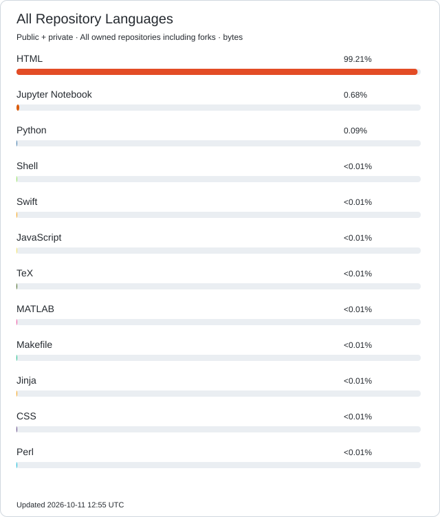
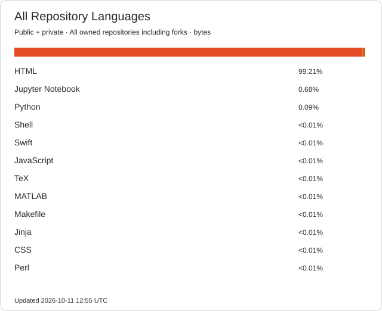
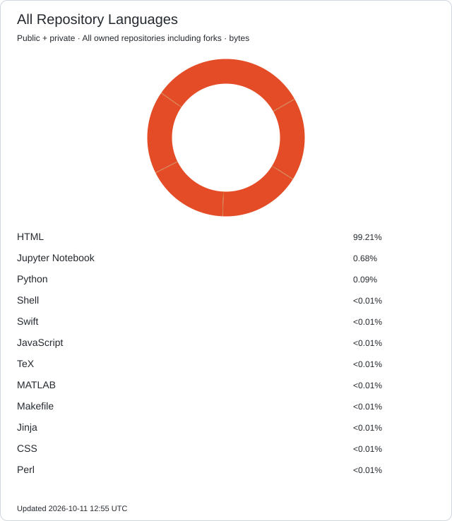
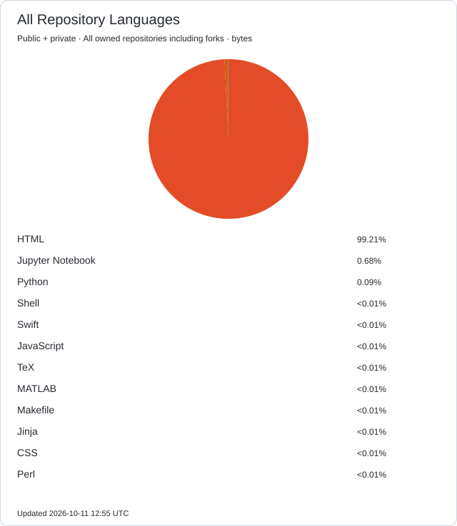
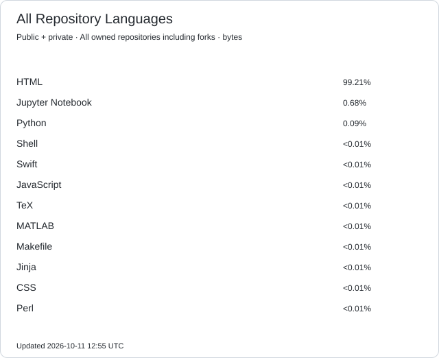
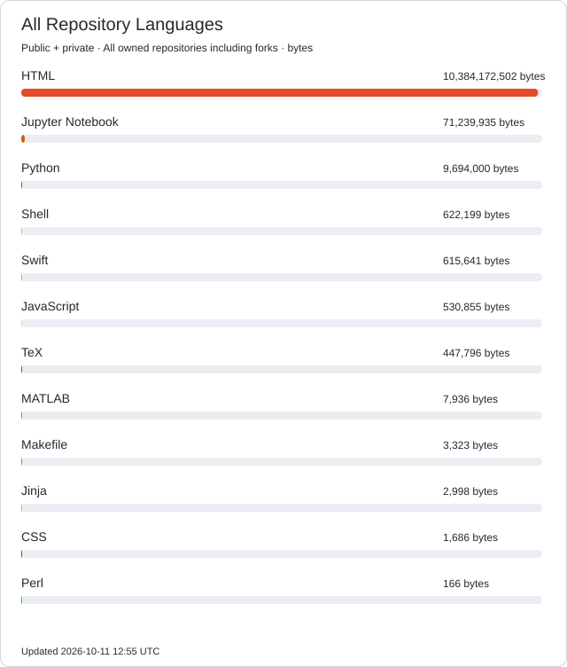

### Hi there, I'm Kaibiao ZHU 👋

I'm a master's student at the Hong Kong University of Science and Technology (Guangzhou).

🔎 My research interests include:

- Empirical Asset Pricing
- Machine Learning for Finance
- Market Microstructure
- LLM Application in Finance

I'm happy to connect with others who share similar research interests.

📫 Email: [Click to contact me](mailto\:kzhu597@connect.hkust-gz.edu.cn)

<!--
**George-hardworking/George-hardworking** is a ✨ _special_ ✨ repository because its `README.md` (this file) appears on your GitHub profile.

Here are some ideas to get you started:

- 🔭 I’m currently working on ...
- 🌱 I’m currently learning ...
- 👯 I’m looking to collaborate on ...
- 🤔 I’m looking for help with ...
- 💬 Ask me about ...
- 📫 How to reach me: ...
- 😄 Pronouns: ...
- ⚡ Fun fact: ...
-->

---

## 🌐 Languages — Style Gallery

Automatically generated from all my owned public and authorized private repositories, including forks. All detected languages are shown, with no custom language or file exclusions. Current metric: bytes.

### 1. Language list & progress bars

### 2. Compact language bar

### 3. Donut chart

### 4. Vertical donut chart

### 5. Pie chart

### 6. Minimal language names

### 7. Language totals (bytes)

### 8. Icon badge styles (static examples)

These badges are manually specified examples, rather than an automatically calculated language inventory.

<!-- all-repository-languages -->
## Languages Across Public & Private Repositories

All detected languages in my own public and authorized private repositories, including forks. No custom exclusions. Updated daily; the active metric is shown on the cards. Repository names and source code are not published.

[Detailed language totals](./profile/all-languages.json)
